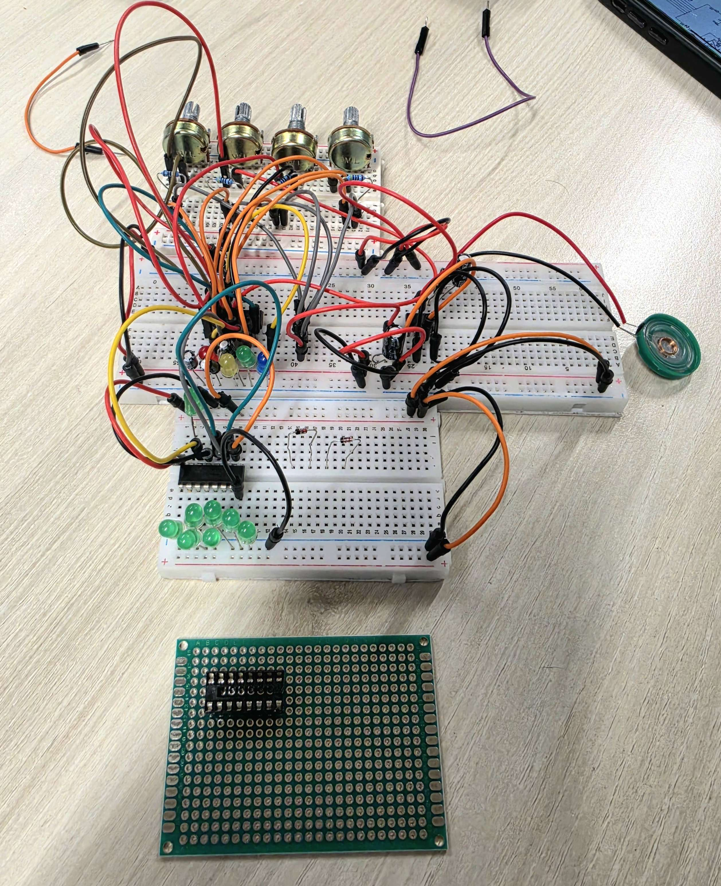
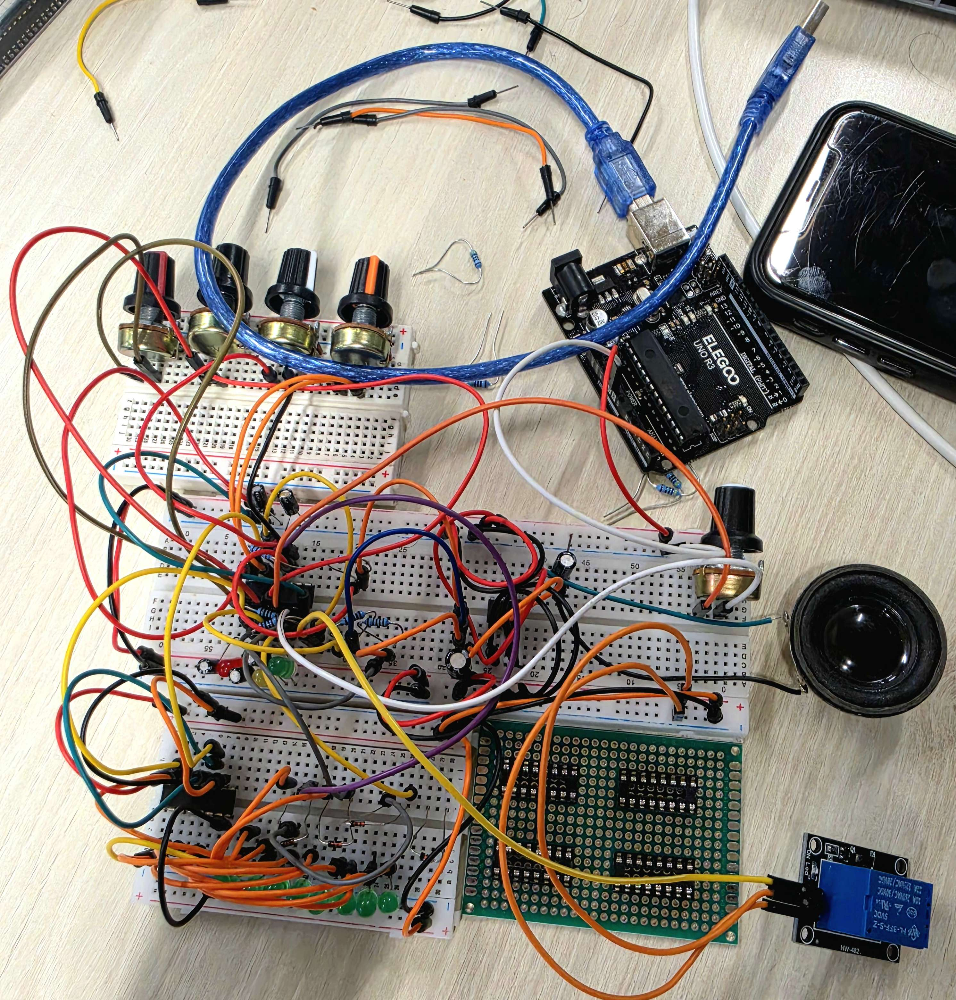
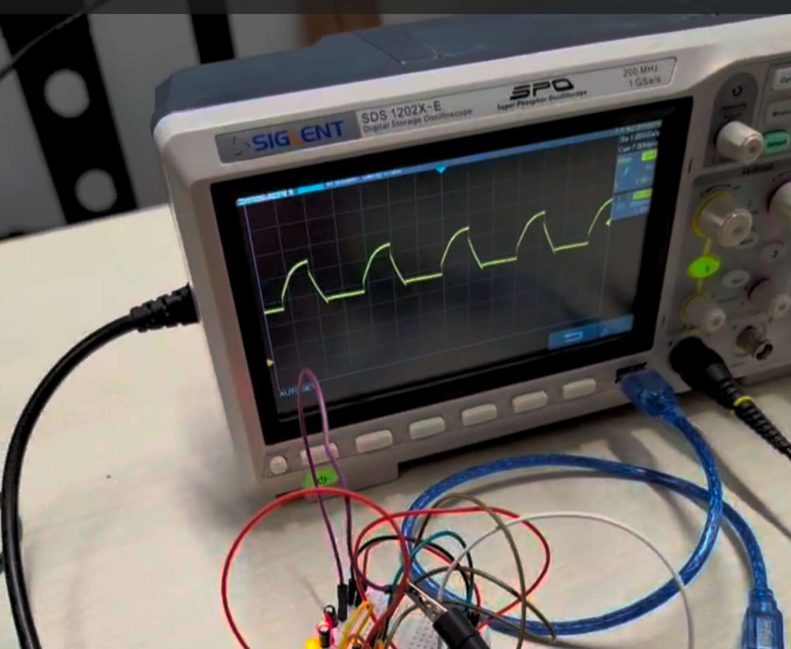
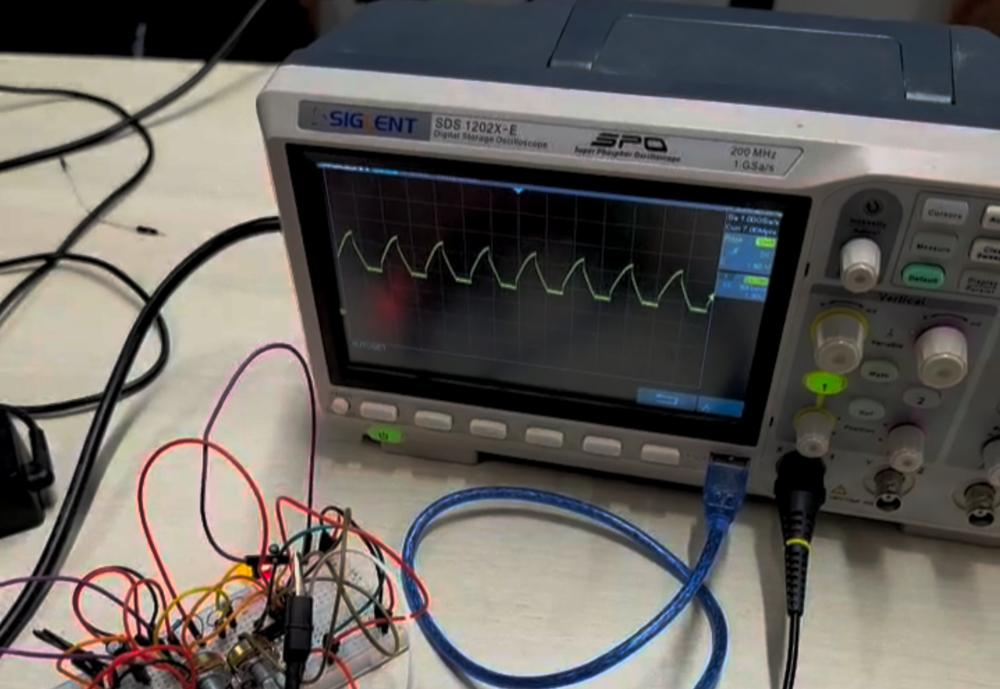
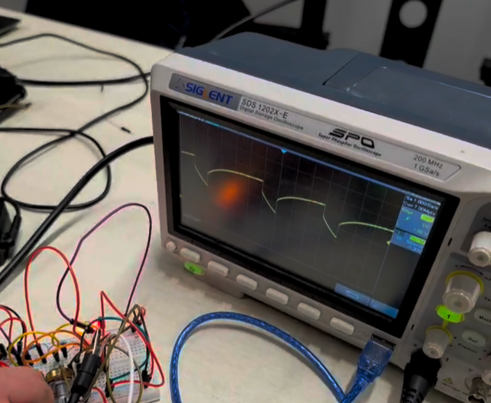
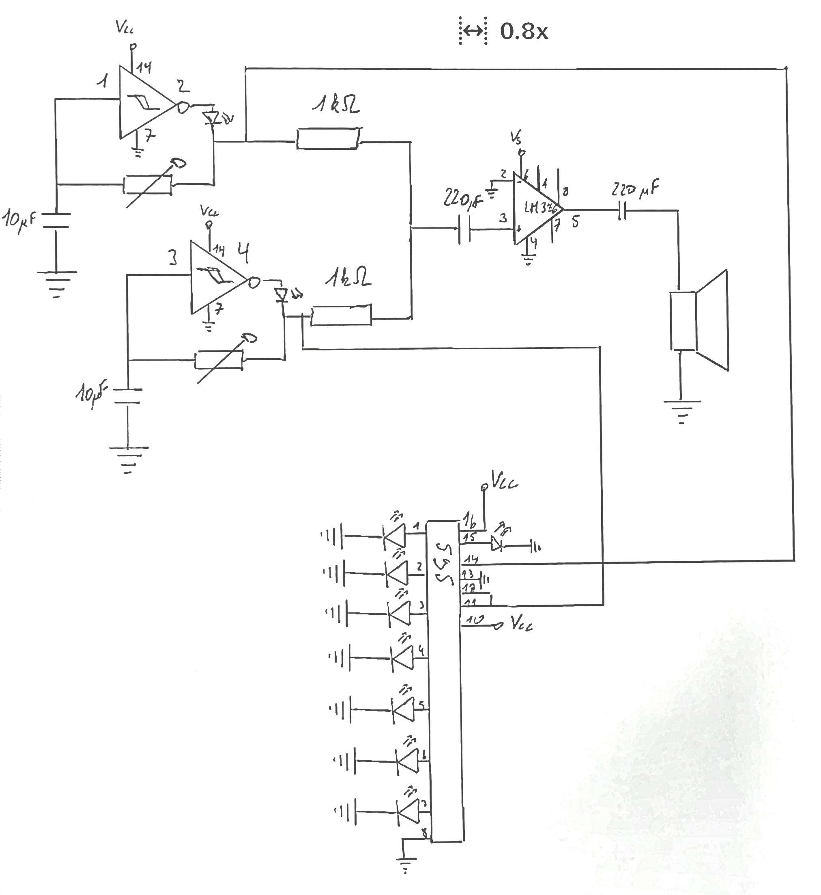
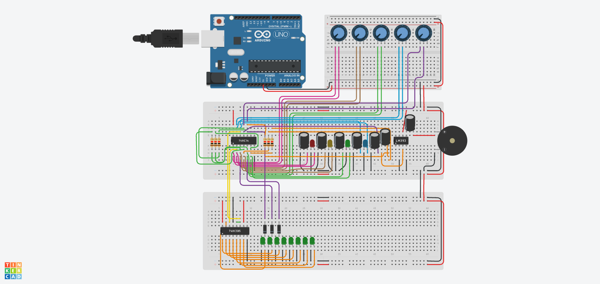
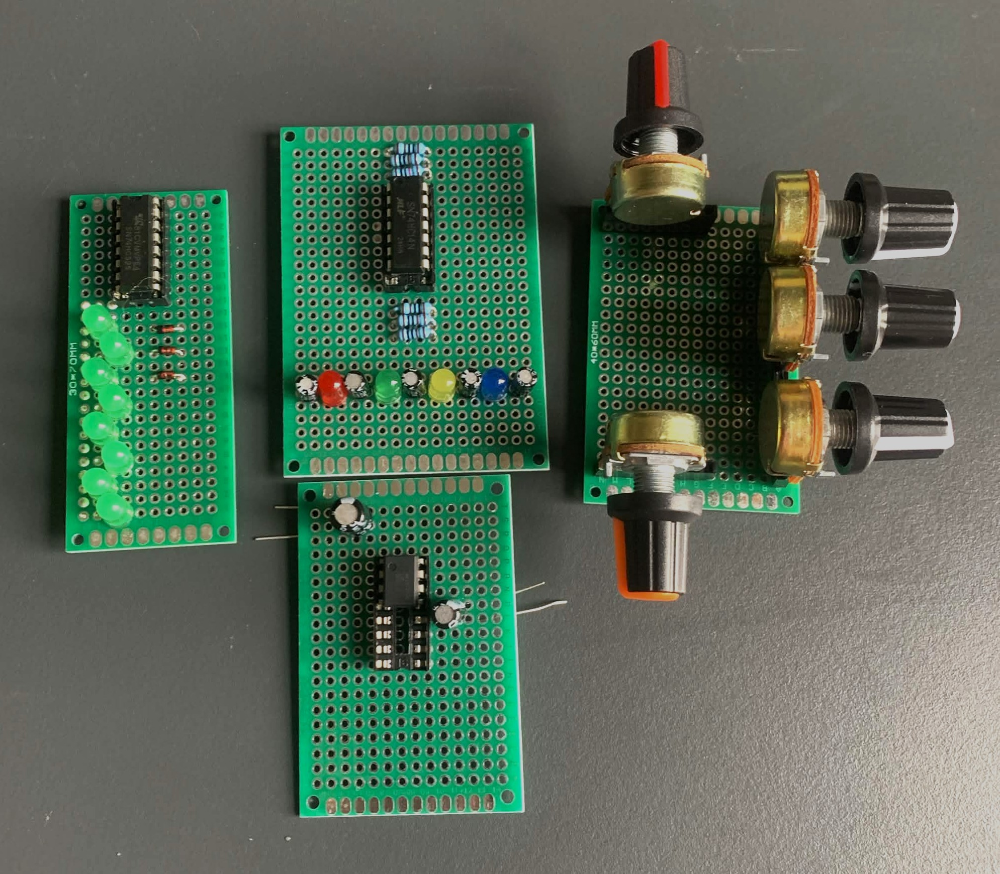

# Audio Synthesizer — Logic Noise, Breadboard Prototypes & KiCad PCB

**Circuits / CreaTech A4 — November 2026**  
**Team:** Ryan Hulton, Paul Lamour

> An experimental audio synthesizer built from digital logic: we explored oscillator circuits on breadboards, documented their waveforms and sounds, modeled a circuit in Tinkercad, and developed an expanded KiCad schematic and PCB layout.


## 1. Concept and learning objectives

This project explores **logic noise**: producing audible signals from inexpensive digital logic rather than using a conventional synthesizer IC or generating all the audio in software. An inverting Schmitt trigger such as the **74HC14** can form a relaxation oscillator when its output is fed back through a resistance and its input is connected to a capacitor. Changing the resistance changes the charge/discharge timing, and therefore the oscillator frequency.

We experimented with several ways to shape and combine these oscillations. The **LM386** provides an audio amplification stage, while a **74HC595** shift register can drive an eight-LED visual output or support a later stepped control/sequencer design. The **Arduino Uno** shown in the Tinkercad setup is used in the prototyping environment; the KiCad PCB should be understood as a separate hardware design, not proof that an Arduino has been mounted on it.

**Main components represented across the experiments and CAD work:**

- **74HC14** — six inverters with Schmitt-trigger inputs, used for RC oscillator stages.
- **Variable resistors / potentiometers** — frequency adjustment.
- **Capacitors and fixed resistors** — timing, mixing, coupling and supporting circuits.
- **LM386** — audio amplifier for a small speaker.
- **74HC595** — 8-bit shift register and LED outputs.
- **LEDs and resistors** — visual indication, including current limiting in the PCB design.

The following is a **documentation of experiments and design work**; it does not claim that the finalized PCB has already been manufactured or physically tested.

## 2. Experimental process and audiovisual documentation

### 2.1 Breadboard experiments — 9 November 2026

These video files contain **video and embedded audio tracks**, so they are the primary audiovisual records of the breadboard sessions. Click each one to watch and listen on GitHub.

| Recording | Preview / focus | Duration |
| --- | --- | ---: |
| [12:20 — Early circuit test](media/20261109_122047.mp4) | Breadboard wiring, hands-on adjustment and a small speaker | ~7 s |
| [14:56 — Hands-on adjustment](media/20261109_145655.mp4) | Adjusting the breadboard circuit during experimentation | ~17 s |
| [15:11 — Oscilloscope measurement](media/20261109_151122.mp4) | Oscilloscope trace while the circuit is connected | ~37 s |
| [17:20 — Illuminated circuit](media/20261109_172049.mp4) | Breadboard prototype with an illuminated green LED | ~19 s |
| [10 November, 15:21 — Extended prototype](media/20261110_152147.mp4) | Multiple breadboards, Arduino, LED indicators and speaker | ~14 s |

*The descriptions above identify what is visible in the recordings. Precise pitch values, measurements and proof of a soldered assembly have not been independently established from the files.*

### 2.2 Breadboard photographs — 10 November 2026

**Prototype and stripboard preparation**



*Figure 1 — Breadboard setup, connected speaker, and a perforated prototyping board. The photo alone does not establish that the circuit is soldered and functional.*

**Expanded experimental setup**



*Figure 2 — More developed breadboard assembly with additional controls, an Arduino board, a speaker and a perforated board.*

### 2.3 Oscilloscope observations

The oscilloscope was used to inspect the changing electrical signals generated by the breadboard circuits. The screenshots show repeating traces; they should not be treated as calibrated measurements without the matching scale/cursor readings.

| Observation 1 | Observation 2 | Observation 3 |
| :---: | :---: | :---: |
|  |  |  |
| [Full image](media/oscilloscope1.png) | [Full image](media/oscilloscope2.png) | [Full image](media/oscilloscope3.png) |

These observations helped us compare the qualitative shapes of the signals while changing the circuit. For a quantitative account, add the actual oscilloscope time/division, voltage/division, probe attenuation and measured frequencies.

### 2.4 Hand-drawn circuit diagram



*Figure 3 — Working circuit sketch: oscillator/mixing concept, LM386 output stage and planned 74HC595 section. This is an experimental sketch, not the final PCB manufacturing drawing.*

## 3. Tinkercad — virtual breadboard and generated schematic

The experiment was also reconstructed in **Tinkercad Circuits** to show its component placement and wiring before the KiCad design stage.

### Virtual breadboard



[Open full-resolution breadboard image](tinkercad/Tinkercad_breadboard.png)

### Generated electronic schematic

**[View the Tinkercad-generated schematic (PDF)](tinkercad/Tinkercad_schematic.pdf)**

The Tinkercad schematic and physical breadboard view are useful references, but the later KiCad schematic was reconstructed separately, with some implementation changes and design checks. In particular, the real **LM386** pinout must be used for the audio stage rather than treating an incorrectly named amplifier in Tinkercad as electrically interchangeable.

> **File-path check:** These two Tinkercad links use the names seen in the project folder (`Tinkercad_breadboard.png` and `Tinkercad_schematic.pdf`). If the GitHub filenames differ, update these two links to match their exact spelling/capitalization.

## 4. KiCad — expanded schematic and PCB design

The KiCad deliverable is stored in:

**[`kicad/Circuits_Audio_Synth_Kicad_VF/`](kicad/Circuits_Audio_Synth_Kicad_VF/)**

| File | Purpose |
| --- | --- |
| [`Circuits_Audio_Synth_Kicad_VF.kicad_pro`](kicad/Circuits_Audio_Synth_Kicad_VF/Circuits_Audio_Synth_Kicad_VF.kicad_pro) | KiCad project settings |
| [`Circuits_Audio_Synth_Kicad_VF.kicad_sch`](kicad/Circuits_Audio_Synth_Kicad_VF/Circuits_Audio_Synth_Kicad_VF.kicad_sch) | Editable schematic |
| [`Circuits_Audio_Synth_Kicad_VF.kicad_pcb`](kicad/Circuits_Audio_Synth_Kicad_VF/Circuits_Audio_Synth_Kicad_VF.kicad_pcb) | PCB component layout and copper routing |
| [`AudioSynth_Local.pretty/`](kicad/Circuits_Audio_Synth_Kicad_VF/AudioSynth_Local.pretty/) | Project-specific footprints |
| [`Custom.kicad_sym`](kicad/Circuits_Audio_Synth_Kicad_VF/Custom.kicad_sym) | Project-specific schematic symbol library |
| `fp-lib-table` and `sym-lib-table` | Local library registrations |

### Second-version concept / added functionality

Compared with the initial oscillator/mixing experiment, the expanded KiCad design brings together **five adjustable oscillator sections**, **LM386 audio output circuitry**, and an **eight-output 74HC595/LED subsystem** on one PCB design. This provides more possible oscillator combinations and visual output/step-sequencer development than the simple initial oscillator setup.

The eight-LED shift-register section is a **design feature**, not evidence that a complete clocked musical sequencer has been demonstrated on a finished PCB. If the assessment requires an implemented novel behavior, the team should document its actual operation and what was added relative to the **soldered** V1 circuit.

### Layout and verification

- Components are arranged in functional groups: oscillator/timing networks, logic and amplifier ICs, and LED outputs.
- The PCB uses routed front/back copper and a ground copper zone.
- The **last KiCad DRC screenshot provided for the final v8** reported **0 errors**, **0 warnings**, **0 unconnected items**, and **0 schematic/PCB parity discrepancies** (with **5 ignored tests**).
- **These results are CAD rule checks, not a functional test or an assurance of manufacturability.** Actual component-body dimensions and custom footprint geometries must be compared with the parts that will be soldered.

To edit the design, open the `.kicad_pro` file from the directory above and keep the local symbol and footprint libraries in their existing relative positions.

## 5. Soldered prototype

### 5.1 Assembly and soldering progress

After testing our audio synthesizer circuits on breadboards, we began transferring the components onto perforated prototyping boards to build a more permanent physical prototype.

**The soldering process has not yet been completed successfully.** We encountered difficulties assembling the boards and making reliable electrical connections between the components. The photograph below shows the current assembly progress, including the boards for the LED outputs, electronic components and adjustable controls.



*Figure 4 — Work-in-progress assembly on perforated prototyping boards. The soldering and interconnections have not yet been finalized.*

### 5.2 Current status and next steps

Although we tested various oscillator circuits during the breadboard experiments, **we cannot yet confirm that the soldered assembly works**. No functioning soldered prototype has been demonstrated at the time of submission.

Our next steps are to complete the solder joints and wiring, check continuity and possible short circuits, verify the power connections, and test the assembled synthesizer before recording evidence of its operation.

This section documents the unfinished state of the physical prototype rather than presenting it as a completed or verified circuit.

## 6. What we learned and possible next steps

- Simple Schmitt-trigger logic can be used as an experimental sound source with RC feedback.
- Potentiometers change oscillator timing and can create a wide range of audible behavior.
- An oscilloscope is useful for comparing waveforms and investigating unexpected behavior.
- Moving from breadboard experiments to Tinkercad and KiCad requires careful attention to physical pinouts, power rails, resistor values, PCB footprints and track clearances.
- A successful ERC/DRC is necessary for CAD verification, but does **not** guarantee the actual circuit will work after assembly.

Possible future work includes demonstrating a fully clocked 74HC595-driven step pattern, measuring oscillator frequencies quantitatively, testing the soldered hardware and producing a fabrication-verified revision with confirmed component footprints.

## 7. Repository organization

```text
Circuits_Audio_Synthesizer/
├── README.md
├── kicad/
│   └── Circuits_Audio_Synth_Kicad_VF/
│       ├── Circuits_Audio_Synth_Kicad_VF.kicad_pro
│       ├── Circuits_Audio_Synth_Kicad_VF.kicad_sch
│       ├── Circuits_Audio_Synth_Kicad_VF.kicad_pcb
│       ├── AudioSynth_Local.pretty/
│       ├── Custom.kicad_sym
│       ├── sym-lib-table
│       └── fp-lib-table
├── tinkercad/
│   ├── Tinkercad_breadboard.png
│   └── Tinkercad_schematic.pdf
└── media/
    ├── 20261109_122047.mp4
    ├── 20261109_145655.mp4
    ├── 20261109_151122.mp4
    ├── 20261109_172049.mp4
    ├── 20261110_102235.jpg
    ├── 20261110_143109.jpg
    ├── 20261110_152147.mp4
    ├── hand_drawn_circuit.jpg
    ├── oscilloscope1.png
    ├── oscilloscope2.png
    └── oscilloscope3.png
```

---

**Course context:** Logic Noise / Digital Oscillators workshop, CreaTech Circuits, November 2026.  
**Repository:** https://github.com/Hultoncity2330/Circuits_Audio_Synthesizer
